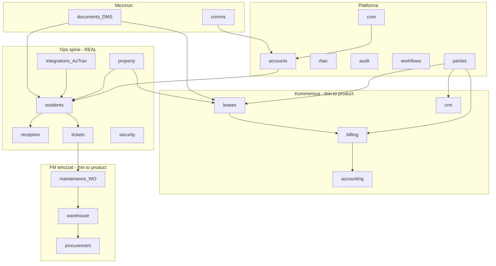

# City Point — Tam məhsul təhvil roadmap-i

Bu plan **MVP sərhədini keçib** sistemi tam bina-ops + kommersiya ERP kimi vermək üçündür. Əsas mənbələr: [`phase0-recommended-order.md`](docs/architecture/phase0-recommended-order.md), [`CityPoint_Tam_Texniki_Plan.md`](docs/architecture/CityPoint_Tam_Texniki_Plan.md), [`finish-requirements.md`](docs/architecture/finish-requirements.md), [`master-plan-progress.md`](docs/architecture/master-plan-progress.md), [`MVP_YUKLENMELI_SENEDLER.md`](docs/deployment/MVP_YUKLENMELI_SENEDLER.md).

**Stop qaydası:** Phase 3+ kommersiya dərinləşməsi Phase 1 pilot DoD tamamlanmadan «product-complete» sayılmır. AxTrax **write** yalnız vendor API təsdiqlənəndə; v1-də oxuma kifayətdir.

**Təxmini tam DoD:** ~6–10 ay (Tam Texniki Plan §11).

---

## Modul xəritəsi və əlaqələr

| Modul | Cari | Hədəf product | Əsas əlaqələr |
|-------|------|---------------|---------------|
| accounts / portal | REAL | REAL + invite SMTP/link stabil | residents, comms |
| reception | REAL | REAL (temp card write opsional) | residents, property, integrations |
| tickets | REAL | REAL + SLA/taxonomy təsdiqli | residents, maintenance, crm |
| residents / security | REAL | REAL + kart status qaydaları | integrations, tickets, property |
| property | REAL (planlar) | REAL + meta/foto + occupancy SoT | leases, residents, drawings |
| parties | thin dual-read | SSOT Party/Person cutover | leases, crm, billing, procurement |
| leases | thin | Production icarə DoD | parties, property, billing, documents |
| crm | thin | Lead→Offer→Lease e2e | parties, leases, api |
| maintenance | thin | WO/PM/inspection DoD | tickets, warehouse, billing |
| warehouse | thin | Stok/hərəkət/hesabat DoD | maintenance, procurement |
| procurement | thin | PR→PO→receive DoD | warehouse, workflows, parties |
| documents | thin | Tam DMS/kargüzarlıq | residents, leases, portal |
| comms | partial | Elan + outbox worker | accounts, portal |
| billing | thin | Charge/Invoice/Payment + portal | leases, maintenance, accounting |
| accounting | thin | Real CoA + bağlanış | billing |
| rbac / workflows | thin | Tam enforcement + approval matrix | bütün ERP yazıları |
| reporting | partial KPI | BI + eksport | bütün domenlər |

---

## Cavablandırılmalı suallar (ətraflı izah)

Mənbə: [`finish-requirements.md`](docs/architecture/finish-requirements.md).  
Bu suallar «maraq üçün» deyil — hər biri konkret modulun **qayda mühərrikini**, UI-ni və ya ops prosedurunu kodlaşdırmaq üçün lazımdır. Cavabsız qalsa engineering UX/test davam edə bilər, amma müvafiq faza **business-complete** sayılmır.

---

### A — Biznes / proses

#### A.1 — SLA (response/resolution) + iş təqvimi/bayramlar

**Status:** cavablandı · tətbiq olunub — bax [`BUSINESS_DECISIONS.md`](BUSINESS_DECISIONS.md)

**Nə soruşulur:** Hər ticket tipi/kateqoriya/prioritet üçün cavab müddəti (response) və həll müddəti (resolution) saatla; həftənin iş günləri, iş saatları (məs. 09:00–18:00); bayram/istirahət günləri siyahısı.

**Nə üçün lazımdır:** Service Desk-də SLA timer və «gecikib» badge-ləri yalnız bu rəqəmlərlə işləyir. Təqvim olmadan sistem həftəsonunu da iş saatı sayıb yanlış eskalasiya verir. Phase 6 DoD və rəhbərlik KPI-ləri (orta həll vaxtı) bu cavaba bağlanır.

**Harada təsir edir:** `tickets` (`SlaPolicy`, routing), portal/ERP ticket status, BI hesabatları.

**Cavab (2026-11-11):** Yüksək 4 saat · Normal 8 saat · Aşağı 24 saat; iş günü B.e–Şənbə 09–18; Novruz və dövlət bayramları qeyri-iş. Kritik = 2 saat (əlavə).

---

#### A.2 — Ticket taxonomy təsdiqi (WO-eligible / CRM-eligible)

**Status:** cavablandı · tətbiq olunub — bax [`BUSINESS_DECISIONS.md`](BUSINESS_DECISIONS.md)

**Nə soruşulur:** Yaşayan City Point müraciət növlərinin son siyahısı; hansı altkateqoriyalar Work Order (texniki/FM) yarada bilər; hansılar kommersiya/CRM hunisinə (lid/təklif) düşməlidir.

**Nə üçün lazımdır:** Yanlış taxonomy o deməkdir ki, «kondisioner xarab» satınalmaya və ya «sahə genişləndirmə» Service Desk növbəsinə düşür. WO-eligible flag Phase 7 (FM), CRM-eligible Phase 4 axınını açır. `repair_ticket_routing` seed də bu təsdiqə uyğun yenilənir.

**Harada təsir edir:** `tickets` taxonomy/RoutingRule, `maintenance`, `crm`, portal müraciət formu.

**Cavab (2026-11-11):** Bütün ticketlər WO-eligible; tipə görə kateqoriya filtri (Hadisə ilk 4+Digər, Xidmət texniki/təhlükəsizlik/təmizlik/digər, Kommersiya son 5, Şikayət hamısı); Təklif silinib.

---

#### A.3 — Kart sifarişi owner + status keçidləri

**Status:** cavablandı · tətbiq olunub — bax [`BUSINESS_DECISIONS.md`](BUSINESS_DECISIONS.md)

**Nə soruşulur:** Portalda «kart sifarişi» göndəriləndən sonra kim statusu irəli aparır (Security / Reception / Admin); hansı keçidlər var (`Submitted` → `Under review` → `Approved` → `Prepared` → `Issued` / `Rejected`); AxTrax-dakı `card_number` sahəyə **nə vaxt** yazılır (əl ilə ERP-də, yoxsa yalnız poller sinxronundan sonra).

**Nə üçün lazımdır:** Bu gün modeldə `CardOrderStatus` var, amma UI çox vaxt yalnız «Kart gözləyir» göstərir və status avtomatik irəliləmir. Owner olmadan ticket bağlı qalır və ya iki şöbə eyni işi edir. `card_number` vaxtı səhv olsa, əməkdaş «kart verilib» görünür, amma turniketdə yoxdur (və ya əksinə).

**Harada təsir edir:** `residents` (employee, card_order_status), `tickets` (card-order subcategory), portal əməkdaşlar, Security portal, AxTrax read sync.

**Cavab nümunəsi:** «Security review edir; kart fiziki verildikdə Issued; nömrə AxTrax-a yazılıb poller gətirəndə ERP-də görünür — əl ilə yazmaq qadağandır.»

---

#### A.4 — İcarə qaydaları: rent/SC, indexasiya, depozit, parkinq, fit-out

**Nə soruşulur:** Kirayə (rent) və xidmət haqqı (service charge) necə hesablanır (m² × tarif, sabit məbləğ, qarışıq); illik/indeks artımı düsturu; depozit məbləği və qaytarılma; parkinq icarəyə daxildirmi; fit-out (təmir) dövründə kirayə güzəşti varmı.

**Nə üçün lazımdır:** `leases` + `billing` mühərriki bu qaydalar olmadan yalnız «əl ilə məbləğ yaz» səviyyəsində qalır — product billing (Phase 11) və icarə DoD (Phase 3) mümkün olmur. Hüquqi müqavilə ilə sistem uyğunsuz olsa, faktura mübahisəsi yaranır.

**Harada təsir edir:** `leases`, `billing` (`generate_lease_charges`), CRM offer məbləğləri, sənəd/müqavilə PDF.

**Cavab nümunəsi:** «Rent = rentable m² × AZN/m²; SC ayrıca; indexasiya hər il CPI+2%; depozit 2 ay rent; 1 parkinq daxil; fit-out 30 gün rent free.»

---

#### A.5 — Billing: invoice günü, due days, VAT, cərimə

**Nə soruşulur:** Ayın hansı günü invoice kəsilir; ödəniş müddəti (due days); ƏDV/VAT daxil, əlavə, yoxsa azad; gecikmə cəriməsi (faiz/gün, grace period).

**Nə üçün lazımdır:** Charge→Invoice→Payment axını və portal «borc» ekranı bu təqvimə bağlanır. Muhasibat jurnalı (Phase 12) də invoice tarixinə görə post olunur. Qayda olmadan sistem demo məbləğləri ilə qalır.

**Harada təsir edir:** `billing`, portal finance (gələcək), `accounting` JE, KPI AR aging.

**Cavab nümunəsi:** «Hər ayın 1-i invoice; 10 gün due; qiymətlər ƏDV-siz + 18% sətir; 5 gün grace sonra ayda 1% cərimə.»

---

#### A.6 — Real Chart of Accounts + jurnal kim yazır

**Nə soruşulur:** City Point-in real hesab planı (kassa, bank, debitor, gəlir, xərc kodları) — indi seed-də minimal 1000/1100/4000 var; kim jurnal yazır / bağlayır (muhasib rolu, yoxsa yalnız sistem avtomatik invoice→JE).

**Nə üçün lazımdır:** Phase 12 trial balance və period close saxta CoA ilə «tamamlanmış» sayıla bilməz. Rol olmadan hər admin jurnal silə/yazı bilər — audit riski.

**Harada təsir edir:** `accounting`, `billing` (invoice→JE), RBAC, audit.

**Cavab nümunəsi:** «CoA Excel əlavə olunur; invoice JE avtomatik; əl ilə düzəliş yalnız Accountant; ay bağlanışını Management təsdiqləyir.»

---

#### A.7 — Approval matrix: lease / PR / offer / sensitive docs

**Nə soruşulur:** Hansı sənəd/əməliyyat təsdiq tələb edir; kim 1-ci / 2-ci imza; məbləğ həddi (məs. PR > 5000 AZN → Management).

**Nə üçün lazımdır:** `workflows.ApprovalService` cədvəli boş qalarsa lease aktivləşməsi, satınalma PO, CRM offer və həssas PDF-lər ya heç təsdiqsiz keçəcək, ya da soft-block ilə dayanacaq. Phase 3/4/9/10 DoD-nin bir hissəsidir.

**Harada təsir edir:** `workflows`, `leases`, `procurement`, `crm`, `documents`, RBAC.

**Cavab nümunəsi:** «Lease və Offer → Property + Management; PR <2000 Desk, ≥2000 Management; hüquqi müqavilə PDF → Management.»

---

#### A.8 — Elan siyasəti: bina-elmi vs şirkət; kim nəşr edir

**Status:** cavablandı · tətbiq olunub — bax [`BUSINESS_DECISIONS.md`](BUSINESS_DECISIONS.md)

**Nə soruşulur:** Default elan bütün binaya gedir, yoxsa yalnız seçilmiş şirkətə; kim yarada/nəşr edə bilər (Admin, Management, Property); Outlook mailbox-dan avtomatik elan icazəlidirmi.

**Nə üçün lazımdır:** Phase 1-də scope (building/company) kodda var; siyasət olmadan ya bütün rezidentlər yad şirkətin elanını görür, ya heç kim elan tapa bilmir. Portal trust və spam riski.

**Harada təsir edir:** `comms` (Announcement), portal, Outlook poller, RBAC.

**Cavab nümunəsi:** «Default bina-elmi; şirkətə yönəlmiş yalnız Admin; Outlook poll aktiv, amma publish əl ilə təsdiq.»

---

### B — İntegrasiya (LAN)

#### B.1 — SMTP/Exchange yoxsa `CP_OFFLINE=1` invite-by-link

**Nə soruşulur:** Daxili poçt serveri (LAN Exchange/SMTP) varmı və invite/reset ora gedəcək, yoxsa air-gap rejimində admin linki kopyalayıb rezidentə ötürəcək (`CP_OFFLINE=1`, file outbox).

**Nə üçün lazımdır:** Portal onboarding və şifrə sıfırlama bu seçimdən asılıdır. SMTP vəd edilib işləməsə, pilot istifadəçilər heç vaxt daxil ola bilməz. Offline yol seçilsə, UI və runbook «linki kopyala» olmalıdır — email gözləməmək üçün.

**Harada təsir edir:** `accounts` (invite, reset), `comms` outbox, `.env`, Phase 1 DoD.

**Cavab nümunəsi:** «SMTP yoxdur — CP_OFFLINE=1; admin invite URL-i WhatsApp/əl ilə ötürür.»

---

#### B.2 — Portal/ERP LAN hostname/IP

**Nə soruşulur:** Rezidentlərə və staff-a veriləcək daxili ünvanlar (məs. `http://citypoint.local` / `http://10.x.x.x`); TLS/sertifikat varmı.

**Nə üçün lazımdır:** Çap olunmuş təlimat, bookmark, invite link host hissəsi. Yanlış host → «işləmir» ticket-ləri. Public DNS lazım deyil, amma LAN adı sabit olmalıdır.

**Harada təsir edir:** nginx, invite email/link template, NetAdmin sənədləri, istifadəçi təlimatı.

**Cavab nümunəsi:** «Portal `http://cp-portal.lan`, ERP `http://cp-erp.lan`, eyni IP, Host header ilə ayrılır.»

---

#### B.3 — AxTrax RO (var); write yalnız vendor sonra

**Nə soruşulur:** Oxuma (RO) hesabının təsdiqi (artıq LAN-da gözlənilir); kart/qonaq **yazma** (grant/revoke) üçün vendor API/sənəd varmı — yoxdursa v1-də write **məqsədyönlü şəkildə** mock qalır.

**Nə üçün lazımdır:** Komanda «qonaq kartı avtomatik AxTrax-a yazılsın» gözləyə bilər; vendor dəstəyi olmadan bu vəd product bug-udur. RO olmadan IN/OUT jurnalı və Security alert işləmir.

**Harada təsir edir:** `integrations` (poller, MockAccessControlAdapter), reception temp access, Phase 5.

**Cavab nümunəsi:** «RO təsdiqli; write API yoxdur — v1-də yalnız oxu; qonaq kartı əl ilə AxTrax UI.»

---

#### B.4 — Website intake: deferred (LAN/VPN yoxdursa)

**Nə soruşulur:** İctimai vebsaytdan lid/sahə sorğusu ERP-yə düşəcəkmi? Air-gap-də birbaşa internet yoxdursa, website→ERP ya VPN/relay ilə, ya Phase 4-də **təxirə** salınır.

**Nə üçün lazımdır:** CRM «Lead from website» DoD-ni bloklamamaq üçün aydın qərar lazımdır. Əks halda API stub «hazır» kimi satılır, amma heç vaxt trafik gəlmir.

**Harada təsir edir:** `api` public, `crm`, Phase 4 DoD.

**Cavab nümunəsi:** «Website intake v1-də yox — lidlər ERP-də əl ilə; API sonra.»

---

#### B.5 — Poller host + Windows Scheduled Task

**Nə soruşulur:** `poll_axtrax` (və lazımdırsa Outlook) hansı maşında 24/7 işləyir; Task Scheduler / service adı; restart siyasəti; kim izləyir.

**Nə üçün lazımdır:** Poller dayananda portal «İçəridə/Çıxış» və Security alert köhnəlir — sistem «işləyir» görünür, data ölüdür. Phase 1 ops DoD-nin kritik hissəsi.

**Harada təsir edir:** `integrations`, SyncLog health, Security/ERP dashboard.

**Cavab nümunəsi:** «ERP hostunda Task Scheduler hər boot-da `poll_axtrax`; NetAdmin həftəlik `axtrax_sync_status` yoxlayır.»

---

### C — Ops

#### C.1 — Offline image transfer prosesi

**Nə soruşulur:** Docker/OS paket yeniləmələri internetsiz serverə necə gətirilir (USB `docker load`, wheelhouse, RPM mirror); kim hazırlayır, kim yükləyir.

**Nə üçün lazımdır:** Air-gapped mühitdə «pip install»/pull işləmir. Proses yazılı deyilsə, təhlükəsizlik yaması və Python asılılığı yeniləməsi dayanır.

**Harada təsir edir:** NetAdmin runbook, deploy zip, Phase 1 hardening.

**Cavab nümunəsi:** «Build staging-də → `docker save` + wheelhouse USB → saytda `docker load` / pip --no-index.»

---

#### C.2 — Backup cədvəli + restore drill

**Nə soruşulur:** Postgres dump və `var/private_media` nə qədər tez-tez, hara (NAS/disk), saxlama müddəti; **restore drill** nə vaxt keçirilib (yalnız backup faylı yaratmaq kifayət deyil).

**Nə üçün lazımdır:** Plan DXF/PDF-ləri git-də yoxdur — media itənsə Temiz/PDF yenidən yüklənməlidir. Drill olmadan «backup var» iddiası yalandır. Product qəbulu üçün məcburi.

**Harada təsir edir:** ops, bütün private sənədlər, Phase 1 DoD, Acceptance.

**Cavab nümunəsi:** «Gecəlik DB + həftəlik media NAS-a; rüblük restore test imzası.»

---

#### C.3 — NTP / time sync sahibi

**Nə soruşulur:** Server və iş stansiyaları hansı vaxt mənbəyinə sinxronlanır; kim cavabdehdir.

**Nə üçün lazımdır:** AxTrax event vaxtı, SLA timer, audit log, invoice tarixi — saat sürüşməsi ilə səhv sıralanır və «kim birinci keçdi» mübahisəsi yaranır.

**Harada təsir edir:** bütün timestamp-lər, poller, SLA, muhasibat.

**Cavab nümunəsi:** «Domain NTP; NetAdmin owner; ERP host domain member.»

---

#### C.4 — Pilot 1–2 şirkət (ad, kontakt, sahə)

**Nə soruşulur:** İlk real (və ya reala yaxın) rezident şirkətlərin hüquqi adı, portal kontakt email/telefon, hansı `space_code`-lar.

**Nə üçün lazımdır:** Phase 1 pilot DoD boş DB-də keçmir. Invite, sənəd, qonaq, ticket scope konkret şirkətə bağlanır. Ad/sahə olmadan UAT skripti yazıla bilməz.

**Harada təsir edir:** `residents`, portal membership, documents, Phase 1–5 UAT.

**Cavab nümunəsi:** «Şirkət A — CP-L012/L013, kontakt X; Şirkət B — CP-L020, kontakt Y.»

---

#### C.5 — Demo seed wipe?

**Nə soruşulur:** Prod/pilot bazasında `seed_demo` məlumatı (saxta şirkət, demo admin şifrələri) silinsinmi, yoxsa ayrı demo mühitində qalsın.

**Nə üçün lazımdır:** Demo qalıqları real pilotla qarışır; təqdimatda saxta adlar görünür; təhlükəsizlik (bilinan demo parol) riski. `SEED_DEMO=0` ilə birlikdə qərar lazımdır.

**Harada təsir edir:** accounts entrypoint, DB təmizliyi, Phase 1.

**Cavab nümunəsi:** «Pilot DB-də demo tam wipe; demo yalnız staging-də.»

---

### D — Məzmun

#### D.1 — Real portal PDF-lər

**Nə soruşulur:** Hər pilot şirkət üçün hansı sənədlər yüklənəcək (icarə, daxili qaydalar və s.); kim hazırlayır; `visible_to_resident=True`.

**Nə üçün lazımdır:** Portal «Sənədlər» boş qalırsa məhsul natamam görünür. Private media git-də olmadığı üçün bu **əl ilə yükləmə** məcburidir — kod bunu əvəz edə bilməz.

**Harada təsir edir:** `documents`, portal, Phase 1/10, [`MVP_YUKLENMELI_SENEDLER.md`](docs/deployment/MVP_YUKLENMELI_SENEDLER.md).

**Cavab nümunəsi:** «Hər pilot üçün müqavilə + qaydalar PDF; Property yükləyir.»

---

#### D.2 — Sahə foto/meta (website üçün; LAN go-live opsional)

**Nə soruşulur:** Sahələrin marketinq fotoları, qısa təsvir, orientasiya — ictimai website/CRM kataloq üçün.

**Nə üçün lazımdır:** LAN ops go-live üçün **mütləq deyil**; Phase 4 website/CRM «boş sahələr» kataloqu üçün lazımdır. Vaxtı planlaşdırmaq üçün opsional/məcburi sərhədi aydın olmalıdır.

**Harada təsir edir:** `property`, `api` public spaces, CRM.

**Cavab nümunəsi:** «v1 LAN-da foto yox; website fazasında Property 20 əsas sahənin fotosunu verir.»

---

#### D.3 — Tarixi Excel/legacy migrasiya varmı?

**Nə soruşulur:** Köhnə Excel/başqa sistemdən gətiriləcək sahə, icarə, əməkdaş, ticket tarixçəsi varmı; format və sahib.

**Nə üçün lazımdır:** Migrasiya varsa `import_lease_spaces` / xüsusi skript və UAT vaxtı lazımdır. Yoxdursa komanda boş yerə migrator yazmır. Gizli «bizdə 5 illik Excel var» son anda scope partladır.

**Harada təsir edir:** property/residents/leases import, Phase 1–3 cədvəli.

**Cavab nümunəsi:** «Yalnız cari sahə siyahısı Temiz-də; köhnə ticket migrasiyası yoxdur.»

---

### Party model checklist (əlavə qərarlar)

Mənbə: [`party-space-lease-model.md`](docs/architecture/party-space-lease-model.md). Phase 2–3 cutover üçün.

#### P.1 — `tax_id` (VÖEN) məcburi?

**Nə üçün:** Party/şirkət yaradılarkən VÖEN boş ola bilərmi. Məcburi olsa portal/ERP validasiya + migrasiya bütün köhnə qeydləri doldurmalıdır; məcburi olmasa billing/e-invoice sonra əlavə sahə tələb edəcək.

#### P.2 — Multi-space lease forması

**Nə üçün:** Bir müqavilə bir neçə sahəni (LeaseLine) əhatə edir, yoxsa hər sahə ayrı Lease. Occupancy SoT, billing sətirləri və vacant m² hesabı buna görə dəyişir.

#### P.3 — Amendment = yeni sətir?

**Nə üçün:** İcarə dəyişikliyi (qiymət/sahə) mövcud Lease-i update edir, yoxsa yeni versiya/sətir + tarixçə. Audit və hüquqi izləmə üçün.

#### P.4 — Slug = Party code?

**Nə üçün:** URL və inteqrasiya kodu kimi `ResidentCompany.slug` Party-nin rəsmi kodu olacaqsa migrasiya və xarici Excel map sadələşir; ayrı kod sistemi seçilsə dual identifikator saxlanılmalıdır.

---

## Sualların faza xəritəsi (qısa)

| Sual | Əsasən hansı faza bloklanır |
|------|------------------------------|
| A.1–A.2 | P6 (+ P7/P4 flag-lər) |
| A.3 | P5 |
| A.4 | P3, P11 |
| A.5 | P11, P12 |
| A.6 | P12 |
| A.7 | P3, P4, P9, P10 |
| A.8 | P1, P10 |
| B.* / C.* | P1 (gateway) |
| D.1 | P1 |
| D.2 | P4 (opsional P1) |
| D.3 | P1–P3 |
| P.1–P.4 | P2–P3 |

---

## Yüklənməli sənədlər (fazalara görə)

Tam siyahı: [`MVP_YUKLENMELI_SENEDLER.md`](docs/deployment/MVP_YUKLENMELI_SENEDLER.md) — product üçün genişləndirilir.

| Faza | Yüklə / import |
|------|----------------|
| P1 | Deploy zip; `.env` saxla; Temiz DXF/PNG + `space_drawing_map.csv`; pilot 1–2 PDF; ≥1 prosedur PDF; ≥1 elan; backup |
| P3 | Bütün sahə planları tamam; icarə müqavilə PDF-ləri; sahə foto (istəyə) |
| P4 | CRM offer şablonları / marketinq material (LAN website olarsa) |
| P5 | Kart sifarişi üçün ID nüsxələri; security mərtəbə planları |
| P7–P9 | Anbar SKU kataloq (Excel/CSV); podratçı/təchizatçı master; WO material siyahıları |
| P10 | Tam kargüzarlıq sənəd növləri + nümunə PDF-lər + görünürlük |
| P11–P12 | CoA Excel; tarif/cərimə cədvəli; nümunə invoice PDF layout |
| P13 | KPI tərifi sənədi (rəhbərlik) |

---

## Phase 1 — Production Hardening (İNDİ / gateway)

**Məqsəd:** 1–2 real pilot şirkətlə kritik ops axınları qüsursuz.

**Modullar:** accounts, portal, reception, tickets, residents, security, integrations, property (planlar), documents, comms.

**Qurulacaq / tamamlanacaq**
- `portal_active` gate, announcement scopes, SEED_DEMO=0, secret fail-closed  
- SMTP və ya invite-by-link + outbox retry  
- AxTrax poller Scheduled Task + `axtrax_sync_status` yaşıl  
- Backup/restore drill (DB + `var/private_media`)  
- `repair_ticket_routing` prod-da  
- Temiz import + pilot PDF/prosedur/elan  

**Sual:** A.8, B.1–B.5, C.1–C.5, D.1  

**DoD:** Pilot login; qəbul; ticket; IN/OUT (poller); kart sifarişi göndərmə; elan; sənəd download; plan icazəsi. Demo seed wipe qərarı tətbiq olunub.

**İstinad:** [`phase1-pilot-checklist.md`](docs/deployment/phase1-pilot-checklist.md), [`phase1-hardening-progress.md`](docs/deployment/phase1-hardening-progress.md).

---

## Phase 2 — ERP Core (təməl möhkəmləndirmə)

**Məqsəd:** Party dual-read stabil; RBAC kodları; audit/events; ApprovalService hazır kommersiya fazalarına.

**Modullar:** parties, rbac, workflows, audit, core (Org tree).

**Qurulacaq**
- `sync_parties` prod rutin; dual-read resolvers bütün yeni yazılarda  
- PermissionCode kritik ERP əməliyyatlarına bağlama planı  
- ApprovalRequest UX skeleton (matrix P3+ ilə doldurulur)  
- OrgDepartment ↔ TicketDepartment uyğunlaşdırma qərarı  

**Sual:** Party checklist; A.7 (matrix layihəsi)  

**DoD:** Party/Person siyahı; audit trail nümunə axınlarda; RBAC cədvəli seed tam.

**İstinad:** [`phase2-erp-core.md`](docs/architecture/phase2-erp-core.md).

---

## Phase 3 — Property / Space / Lease

**Məqsəd:** Əmlak + icarə kommersiya məhsulu.

**Əlaqə:** property ←→ leases ←→ parties; documents (müqavilə); billing fields hazırlığı.

**Qurulacaq**
- Lease create/activate/terminate tam UX; LeaseLine multi-space  
- Rent/SC, deposit, indexasiya, parkinq, fit-out (A.4 cavabına görə)  
- `Space.resident` occupancy SoT-dan LeaseLine-a keçid (dual-write → cutover)  
- Sidebar «İcarələr» yenidən aktiv (nav_leases)  
- Sahə meta/foto tamamlama  

**Yüklə:** bütün Temiz planlar; icarə PDF-ləri  

**Sual:** A.4; Party multi-space; amendment qaydası  

**DoD:** Draft→Active→Terminate; portalda müqavilə görünür; vacant m² KPI düzgün.

---

## Phase 4 — CRM + Website/API

**Məqsəd:** Lead→Opportunity→Offer→Lease draft e2e.

**Əlaqə:** crm → parties → leases; api public; tickets (commercial handoff).

**Qurulacaq**
- CRM staff UX (lidlər, təkliflər, status keçidləri)  
- Offer → `LeaseService.create_draft`  
- Commercial ticket → Opportunity link  
- Public API OpenAPI + LAN website və ya VPN path (B.4)  

**Yüklə:** offer şablonları (PDF)  

**Sual:** B.4; A.7 (offer approval)  

**DoD:** Bir liddən aktiv icarə draft-ına qədər ssenari demosuz qırıqsız.

---

## Phase 5 — Resident / Reception / Access tamamlanması

**Məqsəd:** Ops spine product-complete (write olmadan).

**Əlaqə:** residents ↔ integrations; reception; security; tickets (card-order).

**Qurulacaq**
- Kart status maşını UI (A.3); `card_order_status` ERP/Security-də yenilənir  
- Credential/AccessAssignment domeni (TD-14) və ya əməkdaş kartının rəsmi qaydası  
- Reception export/jurnal DoD; guest history polish  
- Security plan convert worker stabilliyi; NVR import ehtiyacı  

**Yüklə:** ID nüsxələri; security floor plans  

**Sual:** A.3; B.3 write (sonra); B.5  

**DoD:** Kart sifarişi Submitted→Issued izlənilir; IN/OUT/alert sabit; qonaq lifecycle tam.

---

## Phase 6 — Service Desk evolve

**Məqsəd:** Yenidən yazmadan SLA/taxonomy/notification.

**Əlaqə:** tickets → maintenance (WO); tickets → crm; rbac departments.

**Qurulacaq**
- SLA matrix + business calendar (A.1–A.2)  
- WaitingReasonCode / escalation siyasəti  
- Bildiriş çatdırılması (in-app + email outbox)  
- WO-eligible / CRM-eligible subcategory flags  

**Sual:** A.1, A.2  

**DoD:** Prioritetə görə SLA timer; yanlış şöbəyə düşməyən routing; `repair_ticket_routing` sənədləşmiş.

---

## Phase 7 — Facility Management

**Məqsəd:** Ticket→WO→material→bağlanış (+ billable).

**Əlaqə:** maintenance → tickets, warehouse, billing, property.Asset.

**Qurulacaq**
- WO create-from-ticket UX; status maşını; cost lines  
- MaintenancePlan / Inspection productization  
- Billable WO → Charge  

**Yüklə:** aktiv/contractor siyahıları  

**Sual:** A.2 (WO-eligible)  

**DoD:** Texniki ticket bağlanır; WO tarixçə; material sətiri anbara bağlı.

---

## Phase 8 — Warehouse

**Məqsəd:** SKU/stok/hərəkət/low-stock məhsul.

**Əlaqə:** warehouse ← maintenance; → procurement (PR).

**Qurulacaq**
- SKU master UI; StockMovement; negative guard; low-stock→PR  
- İnventar hesabatı  

**Yüklə:** SKU kataloq (CSV/Excel)  

**DoD:** Issue against WO; low-stock alert; inventar sayımı hesabatı.

---

## Phase 9 — Procurement

**Məqsəd:** PR→Approve→PO→Receive→Stock.

**Əlaqə:** procurement → warehouse, workflows, parties (supplier).

**Qurulacaq**
- PR/PO UX; ApprovalService matrix (A.7)  
- Receive stock movement  
- RFQ comparison (Tam plan DoD-ə daxil; minimal 2 təklif müqayisə)  

**Sual:** A.7  

**DoD:** Low-stock-dan stok artırana qədər e2e; audit event-lər.

---

## Phase 10 — DMS / Kargüzarlıq

**Məqsəd:** Versiyalı sənəd idarəetməsi.

**Əlaqə:** documents → residents, leases, portal ACL.

**Qurulacaq**
- DocumentVersion geniş istifadəsi; tip kataloqu  
- Görünürlük default siyasəti; sensitive doc approval  
- Private media + nginx 403 yoxlaması  

**Yüklə:** tam sənəd növləri + nümunələr  

**Sual:** A.7, A.8 (visibility)  

**DoD:** Upload→version→portal görünürlük→download ACL; kargüzarlıq siyahısı.

---

## Phase 11 — Billing

**Məqsəd:** Charge/Invoice/Payment + portal görünüş.

**Əlaqə:** billing ← leases, maintenance; → accounting.

**Qurulacaq**
- `generate_lease_charges` rutin; invoice+due; payment  
- VAT/cərimə (A.5); portal invoices  
- nav_finance yenidən aktiv  

**Yüklə:** tarif cədvəli; invoice şablon  

**Sual:** A.5  

**DoD:** Aylıq charge→invoice→ödəniş; portalda borc görünür.

---

## Phase 12 — Accounting

**Məqsəd:** Real CoA + jurnal + bağlanış.

**Əlaqə:** accounting ← billing.

**Qurulacaq**
- Real CoA seed (A.6); invoice→JE; period close; trial balance  

**Yüklə:** CoA Excel  

**Sual:** A.6  

**DoD:** Invoice jurnalı; trial balance; kim post edir — RBAC ilə.

---

## Phase 13 — Management / BI

**Məqsəd:** Rəhbərlik paneli + eksport.

**Əlaqə:** bütün domen KPI-ləri.

**Qurulacaq**
- Occupancy, vacant m², AR, WO aging, stock, leads KPI  
- Excel/PDF export; həftəlik exec panel  

**Sual:** Rəsmi KPI siyahısı  

**DoD:** 1 panel + 2 export; data quality qəbulu.

---

## Production Acceptance — 7 e2e flow

[`phase0-business-gaps.md`](docs/architecture/phase0-business-gaps.md):

1. Yeni rezident: Website/CRM→Lease→Portal→Access→Billing  
2. Əməkdaş access (kart + IN/OUT)  
3. Qonaq (reception; AxTrax temp write yoxdursa əl ilə qeyd)  
4. Texniki ticket→WO→Warehouse  
5. Commercial ticket→CRM→Offer→Lease  
6. Procurement PR→PO→stock  
7. Lease billing→GL  

**DoD:** Hər flow UAT checklist yaşıl; THIN iddiası yox; Tam Texniki Plan DoD imzası.

---

## Todo ardıcıllığı (icra sırası)

1. **P1 Hardening** — gateway; yükləmələr + suallar B/C/D  
2. **P2 ERP Core** — Party/RBAC/audit  
3. **P3 Property/Lease** — A.4 cavabından sonra dərinləş  
4. **P4 CRM** — eyni vaxtda API/website qərarı  
5. **P5 Access** — kart qaydaları A.3  
6. **P6 Service Desk** — A.1–A.2  
7. **P7 FM → P8 Warehouse → P9 Procurement** (zəncir)  
8. **P10 DMS** (P3/P5 ilə paralel başlana bilər; acceptance-dən əvvəl bitməlidir)  
9. **P11 Billing → P12 Accounting** (A.5–A.6)  
10. **P13 BI**  
11. **Production Acceptance** (7 flow)

**Paralel icazə:** P10 məzmun yükləmələri P3–P5 ilə; P13 KPI tərifi erkən; AxTrax write heç vaxt kritik path-də gözləməsin.

---

## Deliverable (plan təsdiqindən sonra)

Plan təsdiqlənəndə bu roadmap ayrıca yaşayan sənəd kimi yazılacaq: [`docs/architecture/PRODUCT_DELIVERY_TODO.md`](docs/architecture/PRODUCT_DELIVERY_TODO.md) — fazalar, modul əlaqələri, sual checklist, yükləmə siyahısı, DoD. İcra isə Phase 1-dən başlayacaq (istifadəçi «execute» dedikdə).

