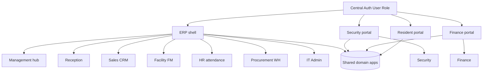
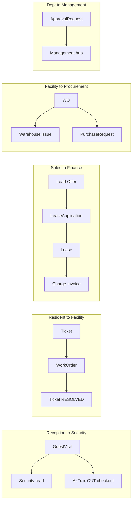

# CITYPOINT ERP — Department-Based Architecture Blueprint (Phase 1)

**Mode:** Read-only specification (Phase 1 deliverable).  
**Basis:** Repository state 2026-11-19 + architecture audit.  
**Principle:** Reorganize and stabilize — one PostgreSQL DB, shared domain apps, existing portals (`/erp/`, `/portal/`, `/security/`, `/finance/`).

**Status footer (post-blueprint):** Phase 2 Centralized RBAC was subsequently implemented (permission catalog extended; dual-gate enforcement; soft-deny flash; test matrix green). Phase 3 (department dashboards & permission-aware nav) requires explicit approval and must not start from this document alone.

---

## 1. Department architecture (how workspaces exist)

Departments are **workspace shells** (nav + dashboard + KPI + task queues), not new databases or cloned entities.

| Department | Primary Role today | Landing (preserve) | Shell |
|------------|-------------------|--------------------|-------|
| Management | `management` | `/erp/` hub | ERP `cp-theme-crm` + `apps/erp/management_hub.py` |
| Reception | `reception` | `/erp/reception/` | ERP reception branch |
| Security | `security` | `/security/` | `templates/security/base.html` |
| Facility Management | `property_fm` (+ `service_desk` for tickets) | `/erp/` → spaces/tickets/WO | ERP default ops nav |
| HR & Employees | *no Role* — Admin/Management UI | `/erp/internal-staff/access/` | ERP (attendance-only today) |
| Sales & CRM | `sales` | `/erp/` sales dashboard | ERP sales nav + `apps/crm/dashboard.py` |
| Finance & Accounting | `accountant` | `/finance/` | `templates/finance/base.html` |
| Procurement | *no Role* — Management RO module | `/erp/procurement/`, `/erp/warehouse/` | ERP supply links |
| IT & Administration | `admin` | `/erp/` + Django `/admin/` | ERP adminish + `/admin/` |

**Design rule (locked):** Do **not** invent parallel `ResidentCompany`/`Ticket`/etc. per department. New Roles for HR / Procurement / IT only if product requires dedicated logins; otherwise keep composite ownership (Admin/Management/FM) and express department via nav profile + permissions.

Legacy `/management/` remains **redirect skeleton** — real Management workspace is ERP hub (`apps/management/urls.py`).

---

## 2. Department → module mapping

Shared cores (unchanged ownership): Residents, Parties, Property, Leases, Documents, Tickets, Reception, WO/Maintenance, Warehouse, Procurement, Billing/Accounting, Workflows, Notifications, Audit — apps under `apps/*` as today.

| Department | Consumes (EXIST) | Planned / incomplete (mark clearly) |
|------------|------------------|-------------------------------------|
| Management | Approvals, hub KPIs, RO CRM/finance/supply, residents, reports, announcements | Full BI / dept performance scorecards |
| Reception | GuestVisit CRUD, journal, export, resident lookup | AxTrax temp credential write (**blocked vendor**); document handover as Documents entity |
| Security | Events, people-inside, alerts, patrol, plans, guest **read**, tickets | Guest write/handoff; AxTrax write |
| Facility | Spaces, drawings, tickets, WO, building assets | PM plans E2E; auto WO dept handoff to FM |
| HR | Internal staff access/attendance (CP workers) | **Leave**, payroll, org chart product — **not in codebase** |
| Sales | Leads→Opp→Offer→LeaseApplication, spaces, CRM reports | Prod UAT gate; website lead API |
| Finance | Charges, invoices, payments, journals, aging, periods | Signed CoA/VAT; 3-way match |
| Procurement | PR/PO services, warehouse issue/receive services | Operator UI for approve/PO/receive; RFQ compare; GRN doc |
| IT | Django Admin users, `erp:audit`, AxTrax health, role switch | In-app user/RBAC admin UI — **not found** |

---

## 3. Role–permission matrix (current + target direction)

### Current Role enum
`admin`, `management`, `reception`, `service_desk`, `property_fm`, `security`, `accountant`, `sales`, `resident_user` — `apps/accounts/models.py`.

### PermissionCode catalog
Baseline Phase 1 catalog included: `party.*`, `space.*`, `ticket.*`, `lease.*`, `approval.*`, `security.view`, `reception.*`, `residents.export_access`, `document.*`, `report.view`, `audit.view`, `announcement.publish`.

**Phase 2 target (now implemented):** `finance.*`, `warehouse.*`, `procurement.*`, `hr.view`, `crm.*`, `resident.*`, `user.admin` / `user.view`, plus dual-gate enforcement.

### Enforcement model
| Layer | Mechanism | Hook |
|-------|-----------|------|
| Module | `PermissionCode` + RolePermission | `DEFAULT_PERMISSIONS` / `ROLE_MATRIX` |
| Action | `*.view` / `*.edit` / `*.decide` / reception verbs | patterned |
| Record | company/dept scope | `object_scope.py`, `tickets/access.py`, portal_scope |
| Department visibility | nav flags + landing | `context_processors.py`, `routing.py` |
| Approval | `approval.decide` + workflow codes | `workflows/services.py` |

**Rule:** Backend views/APIs must call permission checks independently of nav. Frontend nav is not security.

**Dept → Role matrix (operational):**

| Dept | View | Mutate | Approve |
|------|------|--------|---------|
| Management | MANAGEMENT (+ ADMIN) | Limited (approvals, announcements) | Offer/payment |
| Reception | RECEPTION | Guest visits | — |
| Security | SECURITY (+ ADMIN/MGMT portal) | Alerts ack, patrol (as today) | — |
| Facility | PROPERTY_FM / SERVICE_DESK | Spaces/tickets/WO per role | — |
| HR | ADMIN/MANAGEMENT | Attendance view; leave N/A | — |
| Sales | SALES (+ MGMT/ACCT RO) | SALES only | MANAGEMENT offers |
| Finance | ACCOUNTANT | Billing/journals | MANAGEMENT payments |
| Procurement | MANAGEMENT (+ future buyer) | Services exist; UI thin | Over-limit gap |
| IT | ADMIN | `/admin/`, audit | — |

---

## 4. Navigation and routing specification

**Preserve URLs.** Department UX = role-specific nav branches + dashboard builders.

| Dept | Nav source today | Dashboard |
|------|------------------|-----------|
| Management | `templates/erp/base.html` `management` branch | `build_management_hub` |
| Reception | same, `reception` branch | Redirect to reception (no KPI board) |
| Security | `templates/security/base.html` | `security:home` |
| Facility | ERP default + `nav_property` / tickets / WO | Ops `DashboardView` |
| HR | Management “HR & Employees” → `erp:internal_staff_access` | Hub tile only |
| Sales | ERP `sales` branch | `build_sales_dashboard` |
| Finance | `templates/finance/base.html` | `finance:home` |
| Procurement | Management Inventory/Procurement links | Hub tiles |
| IT | Adminish ERP + `/admin/` | Ops dashboard + AxTrax health |

**Phase 3 intent:** per-department dashboard pages reusing existing list URLs; add KPI strips where missing (Reception, Facility, Procurement, IT) without new domains; permission-aware nav via centralized RBAC flags.

---

## 5. Departmental page structure (EXIST vs PLANNED)

Legend: **E** = exists · **P** = planned/partial · **N** = not in codebase

### Management
- **E** Overall hub, pending approvals, financial/ops KPI tiles, RO module links, reports, announcements  
- **P** Department performance scorecards, richer exec BI  

### Reception
- **E** Guest registration, today’s journal, host/company lookup, export  
- **P** Document handover/return as first-class Documents flow  
- **N** Live AxTrax guest credential write  

### Security
- **E** Access events, people inside, alerts, patrol, incidents UI, AxTrax health (ERP/security)  
- **P** Guest operational handoff from Reception  
- **N** AxTrax write  

### Facility Management
- **E** Buildings/spaces, tickets, WO, building equipment/inventory, inspections models  
- **P** Preventive maintenance E2E; FM inbox for WOs  
- **N** Auto-route ticket→FM dept visibility fix (ACL gap)  

### HR
- **E** Employee directory (CP internal) + attendance/access  
- **N** Leave management, org structure product, payroll  

### Sales & CRM
- **E** Leads, opportunities, offers, activities, CRM performance dashboard/reports  
- **P** Production acceptance; website ingest  

### Finance
- **E** Charges, invoices, payments, journals, reports/aging/periods  
- **P** Real CoA/VAT sign-off  

### Procurement
- **E** PR/PO domain services, suppliers as Party, receive service, warehouse  
- **P** RFQ UI, goods receipt UX, shortage→PR UI  
- **N** Dedicated GRN document type  

### IT & Administration
- **E** User mgmt via Django Admin, roles on User, audit log, integration health surfaces  
- **P** In-app user/RBAC admin; system settings screen  
- **N** Standalone settings app  

---

## 6. Cross-department workflows

| ID | Status | Existing spine | Missing steps |
|----|--------|----------------|---------------|
| **A** Reception→Security | Dev-verified + credential follow-up | Pre-reg/walk-in; cardless portal checkout; card interval match + AxTrax OUT; employee-event exclusion; ambiguous match → `SyncLog`; Security RO journal; `RETURN_PENDING` UI | Live QONAQ UAT (NetAdmin); Security write; guest Documents entity; Security notify; CP employee attendance export (HR/Security) |
| **B** Resident→Helpdesk→Facility | Dev-verified (Workflow B) | Portal intake → routing → explicit Helpdesk `create_wo` → FM assign/complete → Helpdesk resolve/close; TicketAssigned/Resolved + WorkOrderAssigned emits; space/company scope | Auto WO creation (not approved — remains explicit); live UAT |
| **C** Sales→Property→Lease→Finance | Dev-verified (Workflow C) | Offer approval→send→application→lease draft (**RESERVED**); signed future start→`poll_lease_lifecycle` ACTIVE; deposit charge on activate (`start_date` due); expiry notify | CoA/VAT Finance UAT (placeholder CoA); live Sales/Accountant acceptance; separate deposit-due policy if Finance requires |
| **D** Facility→WH→Procurement | Dev-verified (Workflow D) | WO issue/purchase; low-stock→PR; RFQ compare+select (approved/ordered); partial receipt + replay; issue to WO; commitment pending banner | Live FM/WH UAT; priced multi-PO under cumulative ceiling policy if Finance requires |
| **E** Dept→Management | Dev-verified (Workflow E) | Offer + payment + **document.approve** + **procurement.pr** hub; version-bound doc decisions; over/missing-limit escalate; notify on decide | Live Management UAT; CoA track separate |

---

## 7. Database relationship impact

**No new departmental tables required for Phase 1–3 workspace work.**

| Change type | Impact |
|-------------|--------|
| Nav/dashboard only | **Zero** schema |
| RBAC catalog extend | Rows in `PermissionCode` / `RolePermission` only |
| New Roles (HR/Procurement/IT) | `User.role` choices + data migration **if** product demands — deferred (Phase 2 chose no new roles) |
| Workflow fixes (ACL, UI) | Mostly application-layer |
| Dual Party↔ResidentCompany | Unchanged; departments must keep using shared resolvers (`parties/resolvers.py`) |

**Do not** create `ManagementResident`, `SecurityTicket`, etc.

---

## 8. Implementation roadmap (Phases 1–6)

### Phase 1 — Architecture & department mapping *(this document)*
- **Affected:** docs only  
- **DB:** none  
- **Accept:** Blueprint approved; dept↔role↔URL matrix signed  
- **Rollback:** n/a  

### Phase 2 — Centralized RBAC enforcement
- Extend permission catalog; dual-gate views; soft-403 with message  
- **Accept:** Mutating endpoints deny without permission; nav hide ≠ only control  
- **Status:** Implemented after Phase 1 approval  

### Phase 3 — Department dashboards & navigation
- KPI strips; permission-aware nav; landing tweaks; URLs preserved  
- **Deps:** Phase 2  
- **Accept:** Each dept Role sees dedicated nav+dashboard  
- **Gate:** Requires explicit Phase 3 execution approval  

### Phase 4 — Cross-department workflows
- Reception/security guest handoff; tickets↔maintenance ACL; procurement UI; **no AxTrax write**  

### Phase 5 — Audit logging & notifications
- Approve/decide/ticket/WO/guest/procurement transitions call `log_action` + in-app notify  
- **Status:** Dev-verified (Phase 5) — see `apps/core/tests/test_phase5_audit_notify.py`  
- **In-app notify (implemented locally):**
  - Guest arrival: `VISITOR_CHECKED_IN` → portal `created_by_portal_user` (pre-reg only; walk-in no fan-out).
  - Lease activation: `LEASE_ACTIVATED` → active Admin + Management + Sales + Accountant (mirrors expiry commercial roles + Accountant for deposit/billing). **Audience is engineering convention from expiry pattern — no separate City Point written sign-off on this four-role set yet.**
  - Management offer reject: `approval.decided` → offer `requested_by` (Sales); destination offer detail.
  - Customer offer reject: `LeaseApplicationService.reject_offer` → opportunity `owner` (fallback `created_by`).
  - RETURN_PENDING: see consolidated entry under Phase 6 UAT / below.
- **Still deferred (named owners):** every-admission Security/Reception broadcast (CP Reception+Security); Admin-override → Management alert recipients (CP Management); RETURN_PENDING duty-team narrowing (CP).

### Phase 6 — UAT, regression, security testing
- Full regression; role matrix penetration; AxTrax RO unchanged  
- **Status:** Local regression + soft-deny/contract fixes Dev-verified; on-site UAT in `docs/uat/phase6-onsite-acceptance.md`  
- **Discovery:** `apps/comms/tests.py` removed (cases moved to `apps/comms/tests/`); `manage.py test` discovers the package

---

## 9. Testing & acceptance checklist (summary)

- [x] Nine departments mapped to Role/landing/nav without duplicate entities  
- [x] Shared domains only consumed, not forked  
- [x] Backend permission denial without relying on hidden nav *(Phase 2)*  
- [x] Management/Sales/Finance/Security dashboards remain real ORM  
- [x] Incomplete features labeled (Leave **N**, AxTrax write **N**, CoA **P**; Procure UI closed in Workflow D)  
- [x] Workflows A–E: Dev-verified; live UAT deferred to owners *(Phase 4)*  
- [x] Phase 5 audit + in-app notify anchors A–J covered  
- [x] URLs backward compatible; resident/security/finance portals preserved  
- [x] AxTrax remains read-only  

---

## 10. Deliverables index

| # | Deliverable | Section |
|---|-------------|---------|
| 1 | Department architecture | §1 |
| 2 | Department→module mapping | §2 |
| 3 | Role–permission matrix | §3 |
| 4 | Navigation/routing spec | §4 |
| 5 | Workflow diagrams | §5–6 |
| 6 | DB impact analysis | §7 |
| 7 | Implementation roadmap | §8 |
| 8 | Testing/acceptance checklist | §9 |

---

## Strict execution rule

Phase 1 produces **specification only**. No source, schema, permission, URL, or template modifications under Phase 1. Later phases start only after explicit approval.
