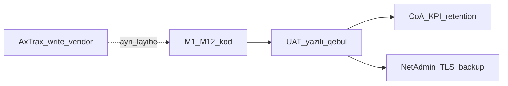

# Mərhələ boşluqları və cavab gözləyən suallar

**Yenilənib:** 2026-11-18  
**Qayda:** M1–M12 Todoist **kod + lokal test** ilə bağlanıb. Bu sənəd production/pilot DoD boşluqlarını və kimdən cavab gözləndiyini izləyir.  
**Əlaqəli:** [finish-requirements.md](finish-requirements.md) · [phase0-module-status.md](phase0-module-status.md) · [../uat/functional-readiness-checklist.md](../uat/functional-readiness-checklist.md)

---

## Qısa vəziyyət

| Qat | Status |
|-----|--------|
| Developer Todoist M1–M12 | Bağlı (thin-real / mock-qəbul) |
| Todoist NetAdmin | **9 açıq** — [netadmin-handoff-checklist.md](../deployment/netadmin-handoff-checklist.md) |
| UAT §A–E operator Pass | **Açıq** — checklist checkbox-lar boş |
| CRM production gate (A7) | **Açıq** — [crm-written-acceptance.md](../uat/crm-written-acceptance.md) |
| Biznes A.1–A.8 / A.10 | Cavablanıb — [BUSINESS_DECISIONS.md](BUSINESS_DECISIONS.md) |
| Ops P0–P2 suallar | **Cavab gözləyir** — [p0-go-live-answers.md](../ops/p0-go-live-answers.md) |

---

## 1. Mərhələ üzrə boşluqlar

| Mərhələ | Kod | Tam görülməyən / defer | Owner |
|---------|-----|------------------------|-------|
| M1 Party | dual-read | Party cutover; portal SoT = `ResidentCompany` | Product + Dev (Phase 2) |
| M2 İcazələr | scope/ACL | RBAC hər yerdə enforce olunmur | Dev |
| M3 Lease | lifecycle | Avto terminate-after-end; formal renewal | Biznes + Dev |
| M4 CRM | hunisi | **Prod gate**; website lid; Meeting Room | **Satış** + UAT |
| M5 Portal/Reception | ops UI | AxTrax **write**; temp guest card mock | Vendor + NetAdmin |
| M6 Tickets | SLA/WO | Commercial→CRM polish; material UAT | Ops + FM |
| M7 FM | PM→WO | Inventar sayımı UAT | FM |
| M8 Anbar/Satınalma | PR/PO | Tam RFQ UI; PO↔invoice | Procurement |
| M9 Sənəd/bildiriş | ACL/outbox | Hüquqi retention; Outlook/Zoho şəbəkə qərarı | Hüquq + NetAdmin |
| M10 Billing | JE/portal | **Real CoA**; TB UAT; statutory yox | **Mühasib** |
| M11 Hesabatlar | exec hub | Rəsmi KPI siyahısı; PDF | Rəhbərlik |
| M12 Qəbul | lokal smoke | Staging UAT; NetAdmin drill | Ops |
| NetAdmin | runbook | TLS, DNS, firewall, PG, backup, NTP, offline update | **NetAdmin** |

Modul status cədvəli: [phase0-module-status.md](phase0-module-status.md).

---

## 2. UAT qapıları

Operator checklist: [../uat/functional-readiness-checklist.md](../uat/functional-readiness-checklist.md)

| Bölmə | Kod hazır? | Operator Pass? | Blok |
|-------|------------|----------------|------|
| §A CRM→Lease | Bəli (testlər) | **Xeyr** | CRM prod deploy |
| §B Lease lifecycle | Bəli | **Xeyr** | Pilot commercial |
| §C Daily ops | Bəli (AxTrax RO LAN) | **Xeyr** | Gündəlik istifadə |
| §D Billing | Bəli (placeholder CoA) | **Xeyr** — statutory imza yox | Finance |
| §E Security/ops | Sənəd | **Xeyr** | Go-live |

CRM yazılı qəbul şablonu: [../uat/crm-written-acceptance.md](../uat/crm-written-acceptance.md).

---

## 3. Cavab gözləyən suallar (prioritet)

### P0 — pilotu bloklayan → [../ops/p0-go-live-answers.md](../ops/p0-go-live-answers.md)

1. CRM yazılı qəbul (UAT §A + Satış imza)
2. Daxili mail vs `CP_OFFLINE=1` + link
3. Portal/ERP LAN hostname/IP (+ TLS?)
4. İlk 1–2 pilot şirkət (ad, kontakt, space)
5. Demo wipe?
6. AxTrax RO host/port/user + poller maşını

### P1 — maliyyə / sənəd

7. Real CoA Excel + TB UAT → [../uat/coa-import-uat.md](../uat/coa-import-uat.md)
8. Sənəd retention hüquqi təsdiq
9. Rəsmi KPI siyahısı (M11)
10. Pilot portal sənəd paketi

### P2 — NetAdmin → [../deployment/netadmin-handoff-checklist.md](../deployment/netadmin-handoff-checklist.md)

11–17. OS, DNS/TLS, firewall, PG rolları, backup/restore, NTP, offline update

### P3 — ayrıca layihə

18. AxTrax write (vendor)
19. Website lid intake
20. Party cutover
21. RFQ UI / PO↔invoice / Meeting Room / reklam
22. Tarixi Excel migrasiya?

---

## 4. İzləmə — növbəti addımlar

1. Satış: [crm-written-acceptance.md](../uat/crm-written-acceptance.md) doldur + UAT §A.
2. Ops: [p0-go-live-answers.md](../ops/p0-go-live-answers.md) P0 cavabları.
3. Mühasib: CoA faylı + [coa-import-uat.md](../uat/coa-import-uat.md).
4. NetAdmin: 9 maddə checklist — developer gözləməsin.
5. AxTrax write / Party cutover / website — backlog; sprint DoD-una daxil etmə.
