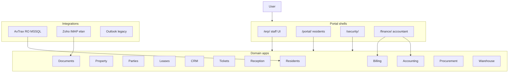

# CityPoint ERP — Full System Architecture Audit

**Date:** 2026-11-27 (refresh of 2026-11-19 plan snapshot)  
**Mode:** Read-only (no code/model/migration changes in this pass)  
**Prior docs:** [phase0-README.md](./phase0-README.md), Phase 0 set (~2026-11-18). This file refreshes the live checkout including Təchizat cutover, shared palette, and AP supplier-invoice work.

---

## 1. System shape

- **26** domain/UI apps under `apps/` ([config/settings.py](../../config/settings.py)).
- **UI shells without domain models:** `erp`, `portal`, `finance`, `api` (thin), `management` (legacy redirects).
- **Stack:** Django CBVs + templates; **no DRF**. JSON via `JsonResponse` under `/api/`.
- **Themes:** shared tokens in `static/css/cp-theme.css`; shell markers `cp-theme-mgmt` / `cp-theme-crm` / `cp-theme-supply` on [templates/erp/base.html](../../templates/erp/base.html).

---

## 2. Module implementation status

Status codes: **işlək** = daily ops MVP · **qismən** = models/UI but incomplete process · **skelet** = scaffold/redirect.

| Module | Status | Backend | Notes (2026-11-27) |
|--------|--------|---------|---------------------|
| accounts / auth / invite | **işlək** | Real | Login, invite, force password, role switch |
| portal (resident) | **işlək** | Real | Scope session; tickets, guests, employees, docs, announcements |
| reception | **işlək** | Real | ERP UI + `/api/reception/*` |
| tickets / helpdesk | **işlək** | Real | Taxonomy, routing, SLA; ERP/portal/security UIs |
| residents | **işlək** | Real | Company, employees, AccessEvent, alerts; management list→detail |
| security portal | **işlək** | Real | Events, people inside, alerts, plans, patrol, tickets |
| AxTrax read sync | **işlək** | Real RO | People/events; write = mock adapter only |
| management ERP hub | **işlək** | Real RO | [apps/erp/management_hub.py](../../apps/erp/management_hub.py); not `/management/` product |
| **Təchizat / Supply** | **işlək** | Real | SERVICE_DESK landing `/erp/dashboards/supply/`; `supply.head` UserPermission-only; pending-approvals RO + ready-to-issue |
| CRM / sales | **qismən** | Real | Full funnel UI; **prod gate** awaiting UAT signature |
| property / spaces | **qismən** | Real | Building/Floor/Space, drawings; occupancy via lease bridge |
| leases | **qismən** | Real | Activate/terminate + lifecycle poller; policy gaps |
| parties | **qismən** | Real | Dual-write with ResidentCompany; cutover incomplete |
| documents | **qismən** | Real | Catalog + download; retention/version policy thin |
| comms / elanlar | **qismən** | Real | In-app + announcements; Zoho IMAP env-gated (`ZOHO_POLL_ON_START` default off) |
| maintenance / WO | **qismən** | Real | WO services + ERP list; PM/materials incomplete |
| warehouse | **qismən** | Real | Stock/issues + UI; E2E UAT thin |
| procurement | **qismən→işlək ops** | Real | PR→PO + Management commitment; RFQ/3-way match still thin; Supply queues live |
| billing | **qismən** | Real | Charge/invoice/payment + **SupplierInvoice AP** |
| accounting | **qismən** | Real | Journals/periods; CoA still placeholder / not statutory |
| finance portal | **işlək UI + AP** | Real | Home work queue; payables HOLD/MATCHED/recognize/settlement; AR inspect pending |
| workflows / approvals | **qismən** | Real | Offer + payment + supplier_payment; generic engine limited |
| rbac | **qismən** | Real tables | Catalog + grants; role checks still dominate many surfaces |
| audit | **qismən** | Real | Explicit `log_action` call sites only |
| api public | **qismən** | Partial | Spaces/leads; mock website adapter |
| `/management/` URLs | **skelet** | Redirects → ERP | Deprecated shell |
| reporting / BI | **qismən** | Real KPIs | Ops/CRM/hub/Supply/Finance dashboards; not BI product |

**Placeholder vs live UI:** Sales/management chrome is layout-only. KPIs use live ORM. No mock metric factories for those dashboards.

---

## 3. Database model map (by domain)

### Identity & access
- `User`, `PortalCompanyMembership`, `PortalInvite` — [apps/accounts/models.py](../../apps/accounts/models.py)
- `PermissionCode`, `RolePermission`, `UserPermission` — [apps/rbac/models.py](../../apps/rbac/models.py)
- `AuditLog` — [apps/audit/models.py](../../apps/audit/models.py)

### Commercial / property
- `ResidentCompany`, `ResidentEmployee`, `AccessEvent`, swipe/shaft alerts — [apps/residents/models.py](../../apps/residents/models.py)
- `Party`, `PartyRole`, `Person` (+ legacy O2O) — [apps/parties/models.py](../../apps/parties/models.py)
- `Building`, `Floor`, `Space`, assets, parking, meters, drawings — [apps/property/models.py](../../apps/property/models.py)
- `Lease`, lines, addons, deposit — [apps/leases/models.py](../../apps/leases/models.py)
- CRM: `Lead`, `Opportunity`, `Offer`, `OfferVersion`, `LeaseApplication`, activities — [apps/crm/models.py](../../apps/crm/models.py)

### Ops
- Tickets taxonomy/routing/SLA/messages — [apps/tickets/models.py](../../apps/tickets/models.py)
- `Guest`, `GuestVisit` — [apps/reception/models.py](../../apps/reception/models.py)
- `WorkOrder`, PM, inspection — [apps/maintenance/models.py](../../apps/maintenance/models.py)
- Warehouse stock/issues — [apps/warehouse/models.py](../../apps/warehouse/models.py)
- PR/PO/RFQ — [apps/procurement/models.py](../../apps/procurement/models.py)
- Security plans/devices/patrol — [apps/security/models.py](../../apps/security/models.py)

### Money & docs & comms
- `Charge`, `Invoice`, `Payment` — [apps/billing/models.py](../../apps/billing/models.py)
- `SupplierInvoice`, `SupplierInvoiceLine`, `SupplierPayment` — [apps/billing/supplier_models.py](../../apps/billing/supplier_models.py)
- `Account`, `JournalEntry`, periods — [apps/accounting/models.py](../../apps/accounting/models.py)
- `Document`, versions — [apps/documents/models.py](../../apps/documents/models.py)
- `Announcement`, `Notification`, `NotificationDispatch` — [apps/comms/models.py](../../apps/comms/models.py)
- `ApprovalRequest` GFK — [apps/workflows/models.py](../../apps/workflows/models.py)
- `ExternalIdentity`, `SyncLog` — [apps/integrations/models.py](../../apps/integrations/models.py)

### Duplicate / overlapping entities

| Overlap | Risk |
|---------|------|
| **Party ↔ ResidentCompany** | Mid-migration dual SoT; portal/tickets/docs still Resident* |
| **Person ↔ ResidentEmployee**; **Person VISITOR ↔ Guest** | Guests not linked to Person |
| **Space.resident vs Lease.party** | Occupancy can diverge without activate bridge |
| **Company contract dates vs Lease dates** | Dual lease date sources |
| **TicketDepartment vs OrgDepartment** | Parallel org models; tickets remain SoT |
| **Asset vs BuildingAsset** | Two asset trees on WO |
| **Announcement.company FK vs companies M2M** | Legacy + new visibility |

Official note: *ResidentCompany remains ops SoT until Party cutover* ([apps/parties/resolvers.py](../../apps/parties/resolvers.py)).

---

## 4. API / routing inventory

| Prefix | App | Nature |
|--------|-----|--------|
| `/erp/…` | [apps/erp/urls.py](../../apps/erp/urls.py) | Main staff UI (incl. Supply dashboards, CRM, WO, WH, procurement queues) |
| `/portal/…` | [apps/portal/urls.py](../../apps/portal/urls.py) | Resident self-service |
| `/security/…` | [apps/security/urls.py](../../apps/security/urls.py) | Security portal |
| `/finance/…` | [apps/finance/urls.py](../../apps/finance/urls.py) | Accountant portal + payables |
| `/accounts/…` | [apps/accounts/urls.py](../../apps/accounts/urls.py) | Invite, role switch, password |
| `/api/v1/public/…` | [apps/api/urls.py](../../apps/api/urls.py) | Public spaces/leads |
| `/api/reception/…` | same | Reception JSON board/mutations |
| `/management/…` | [apps/management/urls.py](../../apps/management/urls.py) | Redirect → ERP |
| `/login/`, `/go/` | [config/urls.py](../../config/urls.py) | Auth entry |

**No REST framework serializers/viewsets.** Ticket domain has no own `urls.py` (mounted via ERP/portal/security).

---

## 5. Auth, RBAC, logging

**Roles (live):** `admin`, `management`, `reception`, `service_desk` (label **Təchizat şöbəsi**), `security`, `accountant`, `sales`, `resident_user`.  
**Retired:** `property_fm` (cleanup/migration residue only).

**Portal routing:** ERP (most staff + Management hub + Supply) · portal (residents) · security · finance (accountant-only).

**Gates:** mixins in [apps/accounts/mixins.py](../../apps/accounts/mixins.py); CRM ACL; tickets ACL (Management RO); nav flags + `is_supply_portal` in [apps/accounts/context_processors.py](../../apps/accounts/context_processors.py).

**Gaps (still true):**
- Soft 403 → silent redirect home (can look like “link broken”)
- RBAC table underused vs hardcoded role checks
- Audit is opt-in (`log_action`), not automatic model auditing
- Lease nav still constrained for many roles (directory/ops surfaces differ)

---

## 6. Dashboards — real vs mock

| Dashboard | Source | Verdict |
|-----------|--------|---------|
| Sales | [apps/crm/dashboard.py](../../apps/crm/dashboard.py) | **Real ORM** |
| Management hub | [apps/erp/management_hub.py](../../apps/erp/management_hub.py) | **Real aggregates** |
| Supply / Təchizat | [apps/erp/department_dashboards.py](../../apps/erp/department_dashboards.py) | **Real** tickets/WO/queues |
| Finance home | [apps/finance/dashboard.py](../../apps/finance/dashboard.py) | **Real** queue counts ↔ drill URLs |
| Ops admin | [apps/erp/views.py](../../apps/erp/views.py) `DashboardView` | **Real** tickets/guests/approvals/AxTrax health |

---

## 7. Cross-module relationships (Residents ↔ others)

| Link | Status |
|------|--------|
| Resident ↔ Space | `Space.resident` FK + lease activate bridge |
| Resident ↔ Documents | `Document.company` FK; portal visibility flag |
| Resident ↔ Tickets | `Ticket.company` FK |
| Resident ↔ Reception | `GuestVisit.company` + host employee |
| Resident ↔ Security | People-inside / events via employees + AccessEvent |
| Resident ↔ Party/Lease/Billing | Dual path; commercial SoT migrating to Party+Lease |
| Resident ↔ Helpdesk WO | Via ticket → WorkOrder |
| Procurement ↔ Finance AP | POLine ↔ `SupplierInvoiceLine`; GR updates `received_qty` only (no GR JE today) |

**Missing / weak:** unified occupancy SoT UI; Guest↔Person; AxTrax write; Ticket→CRM handoff polish; warehouse consumption E2E from ticket/WO.

---

## 8. Integrations

| Integration | Status |
|-------------|--------|
| **AxTrax NG** | Read-only MSSQL sync. Grant/revoke = **MockAccessControlAdapter**. Poller `AXTRAX_POLL_ON_START` (default on when password set). |
| **Zoho → Elanlar** | IMAP poller implemented; `ZOHO_POLL_ON_START` default **off** — needs `.env` + Mail Group + BCC/Sent hardening |
| **Outlook → Elanlar** | Legacy parallel path; `OUTLOOK_POLL_ON_START` default off |
| **Email outbox** | `NotificationDispatch` + poller; default console SMTP in dev |
| **Website** | Public lead/space API; mock website adapter |

---

## 9. Architectural weaknesses

1. **Dual SoT (Party vs ResidentCompany)** — highest structural debt.
2. **God-module ERP views** — large ERP surface area; services improving but uneven.
3. **No DRF / thin public API** — website contract incomplete.
4. **RBAC incomplete enforcement** — role enums dominate.
5. **Soft PermissionDenied UX** — silent home redirect.
6. **AxTrax write forever vendor-blocked** — ERP “card issued” ≠ physical grant.
7. **Finance without signed CoA** — AP lifecycle exists; statutory CoA/VAT open ([BUSINESS_DECISIONS.md](./BUSINESS_DECISIONS.md), [finance-integration-boundaries.md](./finance-integration-boundaries.md)).
8. **Management `/management/` vs ERP hub** — leftover URL confusion.
9. **Static collect / OneDrive + noreload** — stale CSS/templates until collectstatic/restart.

---

## 10. Missing functionality (priority-relevant)

- Party cutover completion; hide dual-write complexity from users
- Zoho production wiring (IMAP/BCC/Sent + Mail Group)
- SMTP + outbox reliability for invites/CRM/tickets
- AxTrax supervised poller reliability in production
- CRM production UAT signature gate
- Lease auto-terminate policy; occupancy consistency
- WO → warehouse material E2E; procurement RFQ depth
- Document retention/version policy
- Real CoA / VAT with accountant; AP over-receive / posted-JE reverse policy
- Management BI beyond hub KPIs
- Website contract completion
- Production TLS/backup (NetAdmin) — ops, not app rewrite

---

## 11. Recommended implementation sequence

Aligned with [phase0-recommended-order.md](./phase0-recommended-order.md), updated for current code:

1. **Production hardening** — secrets, `SEED_DEMO=0`, SMTP, AxTrax poller reliability, backup docs, `collectstatic` discipline  
2. **Comms/Zoho go-live** — Mail Group + env + BCC/Sent poller fixes  
3. **CRM UAT gate** — written acceptance before calling CRM production-ready  
4. **Party↔Resident incremental cutover** — dual-read then single SoT for commercial flows  
5. **Property / Lease occupancy** — activate bridge as SoT; UI consistency  
6. **Resident / Reception / Access** — extend without inventing AxTrax write  
7. **Service desk → WO → warehouse** — close materials E2E on Təchizat  
8. **Facility / PM** — Phase 7 depth  
9. **Procurement RFQ depth** (GRN/match already partially via AP HOLD)  
10. **DMS policy**  
11. **Billing + Accounting CoA UAT** (AP HOLD / GR posting / VAT decisions)  
12. **Management BI** beyond hub  

**Preserve:** Reception, ticket mechanics, security portal, AxTrax **read** path, Supply portal grants, Finance AP reservation rules.

---

## 12. Audit constraints compliance

- No application code modified for this audit pass; no models created; no migrations run; no modules removed/renamed.
- Existing Phase 0 docs remain historical source of truth; this file is the **2026-11-27 code snapshot** for roadmap planning.

---

## 13. Next step (choose one)

After accepting this audit, pick **one**:

| Option | Intent |
|--------|--------|
| **A — Zoho Mail → Elanlar** | Production-ready IMAP/Mail Group wiring, BCC/Sent poller fixes, env checklist |
| **B — Phase 1 hardening** | Secrets/`SEED_DEMO=0`, SMTP/outbox, AxTrax poller reliability, backup/deploy docs |

Do not start both in parallel without an explicit priority.
